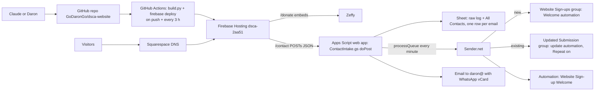

# DSCA website: architecture and operations

As of 2026-10-29 (contact form moved off Google Forms the same day). Full illustrated guide (Claude Doc): https://claude.ai/artifact/J6V85xQRCb4bWnRf7NqMEg

The website runs entirely on cloud services. It does NOT use Daron's home PC
(godarondesk), Tailscale or Cloudflare Tunnel; those belong to his personal home dashboard.

## Services

| Service | Account | IDs | Free limits |
|---|---|---|---|
| GitHub repo + Actions | GoDaronGo | GoDaronGo/dsca-website (public), main; secret FIREBASE_SERVICE_ACCOUNT | free for public repos |
| Firebase Hosting (Spark) | godaron9@gmail.com | project dsca-2aa51; SA github-deploy (Firebase Hosting Admin + Service Usage Consumer) | 10 GB storage, 360 MB/day transfer |
| Squarespace Domains | Squarespace login | deltashorescommunity.com, expires 2027-11-02 (website plan + Email Campaigns cancelled 2026-10-29) | paid yearly |
| Google Workspace (nonprofit) | daron@deltashorescommunity.com | daron@, info@, junior@, monserrat@ | discounted nonprofit plan, billed by Google |
| Google Form (retired) | daron@ | 1_NElptlC1UpTkYmRD_rDYHYMXrQm_UC8ed6uFL8-qrc (published 1FAIpQLScVmfFtk7qoYktc6ws7phrU55YTNkv9npJrNFMEX-3GCDnedg) | free |
| Response sheet | daron@ | 1lufYhdb2fMekOZ1ni7uPiLgKxr0iiHDvTjbqzjJz8D4 (tabs: All Contacts = one row per email, Website Submissions (raw), Form Responses 1 = archive, Imported (old website)) | free |
| Apps Script | daron@ | 1bvN9a6PpoF2IIyimst3vpOKtQuAjVE23Mi15lJIQ0QuD2OVhguEVkIJx; files Code.gs (tools/create-contact-form.gs) + ContactIntake.gs (tools/contact-intake.gs); web app deployment AKfycbxcGs8fK_Uu6UgbwxrDIzZrwyeOWOreZpWsqDlh_UQ22RPR6l8F43Rc2DMQrLPMybkUNg (execute as daron@, access Anyone) = site.json contact_endpoint; Script Properties SENDER_TOKEN, FORM_ID, SHEET_ID, SENDER_GROUP_ID, UPDATED_GROUP_ID, SENDER_FIELDS; triggers processQueue (1 min), onDscaFormSubmit | free |
| Sender.net (Free) | daron@ | groups Website Sign-ups + Updated Submission; automations Website Sign-up Welcome (builder e317kQ) + update email (trigger: joins Updated Submission, Repeat workflow ON); custom fields {{phone_on_file}} {{street_address}} {{community}} {{initiatives}} {{group_chat}} {{block_watch}} {{latest_comment}} {{last_updated}}; domain verified | 2,500 subs, 15,000 emails/mo, Sender footer |
| Zeffy | daron@ | form support-delta-shores-community; bank linked | free |
| Google Analytics 4 | godaron9@gmail.com | account 412947068, property dsca-2aa51 (560129606), web stream "DSCA Website" G-RJ6VRHM49B; site.json ga_measurement_id | free |
| Google Search Console | godaron9@gmail.com | URL-prefix property https://www.deltashorescommunity.com/; verified by old HTML file + GA tag; sitemap.xml submitted 2026-10-29 (37 pages) | free |
| Old sheet (retired) | daron@ | Website Submissions 1OR66QbnmUcNojCybRgWJe039ps8ZSM3uX5gYs2DrXvs | keep as archive |

## DNS (Squarespace)

| Type | Host | Value |
|---|---|---|
| A | @ | 199.36.158.100 |
| TXT | @ | hosting-site=dsca-2aa51 |
| CNAME | www | dsca-2aa51.web.app |
| TXT | @ | v=spf1 include:_spf.google.com include:sendersrv.com ~all |
| CNAME | sender._domainkey | dkim.sendersrv.com |
| TXT | _dmarc | v=DMARC1; p=none |
| MX | @ | Google Workspace (aspmx.l.google.com + alt1-4) |
| TXT | @ | google-site-verification=... |

## Gotchas learned

- Apps Script editor: clicking an option in the function dropdown by accessibility ref does NOT select it; click by coordinates and confirm the label before Run. Running createDscaContactForm by mistake made a duplicate form (now guarded).
- Deploy 403 = service account missing a role (needed Service Usage Consumer).
- Stale CSS after deploy: site.css is cache-busted with ?v=<md5>.
- Sender locks automation emails while Active; deactivate to edit.
- Sender's built-in phone does not fill `{{ phone }}` in automation emails (shows blank); use the custom text field {{phone_on_file}}.
- Sender PATCH /subscribers/{email} with `groups` REPLACES all groups (tested 2026-10-29). Never send groups on update; use POST/DELETE /subscribers/groups/{id}.
- Sender group add/remove takes a few seconds to register; back-to-back remove+add silently skips the add. Pause ~5 s between steps (SENDER_PAUSE_MS).
- Leaving and rejoining a group re-fires a "joins group" automation only when Repeat workflow is ON.
- Website form: the page reads doPost's JSON reply (no preflight: body sent as text/plain). Contact merge rules: blanks never overwrite, Initiatives replace, Comments are a dated history (newest first), Updates counts resubmissions.
- Editing ContactIntake.gs: the web app (doPost) runs the DEPLOYED version. After changing intake/merge code, Deploy > Manage deployments > edit > New version (same URL). processQueue and manual runs use the saved code immediately.
- Form.setCustomClosedFormMessage throws "Invalid data updating form"; the form is closed with setAcceptingResponses(false) only.
- `.btn` sets display, so `hidden` needs an explicit `[hidden]{display:none}` rule.
- Sender Liquid: `{{ firstname | default: "neighbor" }}`; unsubscribe still `{$unsubscribe_link}`.
- Claude can't: click Send/Activate in Sender, edit Squarespace DNS, enter tokens/bank info. Daron does those.

## Squarespace decommission (done 2026-10-29)

Website plan and Email Campaigns cancelled; Squarespace form->Drive link disconnected. No export needed (contacts were already synced to the sheet; no unsubscribes). Domain stays on Squarespace Domains (renews 2027-11-02); DNS verified intact after cancelling (A, www CNAME, MX, SPF, DKIM, DMARC, Google verification).
Optional tidy-up: delete unused Sender form "DSCA Website Mailing List".

## Zeffy (donations + membership)

Admin: daron@ (Treasurer); donor replies go to the admin address. Both campaigns' emails rewritten in DSCA voice on 2026-10-29, signed "Daron Go, Treasurer", with banners hosted at /img/email/donation-thanks.jpg and /img/email/membership-thanks.jpg (static/img/email).
- Donation form "Support Delta Shores Community": thank-you (subject "Thank you for supporting Delta Shores!"), yearly auto-renew reminder ON (30 days), softened 2026-10-29 to a "thank you for last year, we'd love your support again" tone that still states the renewal date/amount and how to change or cancel. Tax receipts auto-generated.
- Membership "Delta Shores Annual Membership" ($25/yr, valid 1 year from purchase, auto-renew offered, member cards on): new description; thank-you, expiration reminder and auto-renew reminder rewritten (Zeffy's renew/manage links kept).
- Website: Take Action page has a "Become a member" section (#membership) linking to site.json zeffy_membership_url (https://www.zeffy.com/en-US/ticketing/delta-shores-community-associations-memberships; slug kept the old campaign name); Donate page and footer link to it.
- Notifications: info@ is a collaborator with ONLY "Notify of new payments", all campaigns (one email per payment). info@ is a Google Group, so board members on it get these.
- Editing gotcha: email bodies are Froala editors; set content by clicking into the visible editor and replacing its range. Variables are `` chips (ticketing labels it "Buyer first name"; same variable).

## SEO

Canonical tag on every page (build.py sets `canonical`), NGO schema.org JSON-LD on the home page, /privacy page (GA section appears when ga_measurement_id is set), sitemap.xml + robots.txt. site.json `google_site_verification` slot exists but is unused (GA verifies Search Console; keep the GA tag or Search Console may lose verification).
