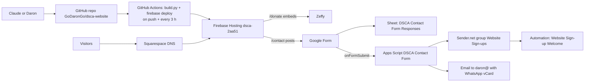

# DSCA website: architecture and operations

As of 2026-10-29. Full illustrated guide (Claude Doc): https://claude.ai/artifact/J6V85xQRCb4bWnRf7NqMEg

The website runs entirely on cloud services. It does NOT use Daron's home PC
(godarondesk), Tailscale or Cloudflare Tunnel; those belong to his personal home dashboard.

## Services

| Service | Account | IDs | Free limits |
|---|---|---|---|
| GitHub repo + Actions | GoDaronGo | GoDaronGo/dsca-website (public), main; secret FIREBASE_SERVICE_ACCOUNT | free for public repos |
| Firebase Hosting (Spark) | godaron9@gmail.com | project dsca-2aa51; SA github-deploy (Firebase Hosting Admin + Service Usage Consumer) | 10 GB storage, 360 MB/day transfer |
| Squarespace Domains | Squarespace login | deltashorescommunity.com, expires 2027-11-02 | paid yearly |
| Google Workspace (nonprofit) | daron@deltashorescommunity.com | daron@, info@, junior@, monserrat@ | free |
| Google Form | daron@ | 1_NElptlC1UpTkYmRD_rDYHYMXrQm_UC8ed6uFL8-qrc (published 1FAIpQLScVmfFtk7qoYktc6ws7phrU55YTNkv9npJrNFMEX-3GCDnedg) | free |
| Response sheet | daron@ | 1lufYhdb2fMekOZ1ni7uPiLgKxr0iiHDvTjbqzjJz8D4 (tabs: All Contacts, Form Responses 1, Imported (old website)) | free |
| Apps Script | daron@ | 1bvN9a6PpoF2IIyimst3vpOKtQuAjVE23Mi15lJIQ0QuD2OVhguEVkIJx; Script Properties SENDER_TOKEN, FORM_ID, SENDER_GROUP_ID; trigger onDscaFormSubmit | free |
| Sender.net (Free) | daron@ | group Website Sign-ups; automation Website Sign-up Welcome (builder e317kQ); domain verified | 2,500 subs, 15,000 emails/mo, Sender footer |
| Zeffy | daron@ | form support-delta-shores-community; bank linked | free |
| Old sheet (retired) | daron@ | Website Submissions 1OR66QbnmUcNojCybRgWJe039ps8ZSM3uX5gYs2DrXvs | keep as archive |

## DNS (Squarespace)

| Type | Host | Value |
|---|---|---|
| A | @ | 199.36.158.100 |
| TXT | @ | hosting-site=dsca-2aa51 |
| CNAME | www | dsca-2aa51.web.app |
| TXT | @ | v=spf1 include:_spf.google.com include:sendersrv.com ~all |
| CNAME | sender._domainkey | dkim.sendersrv.com |
| TXT | _dmarc | v=DMARC1; p=none |
| MX | @ | Google Workspace (aspmx.l.google.com + alt1-4) |
| TXT | @ | google-site-verification=... |

## Gotchas learned

- Apps Script editor: clicking an option in the function dropdown by accessibility ref does NOT select it; click by coordinates and confirm the label before Run. Running createDscaContactForm by mistake made a duplicate form (now guarded).
- Deploy 403 = service account missing a role (needed Service Usage Consumer).
- Stale CSS after deploy: site.css is cache-busted with ?v=<md5>.
- Sender locks automation emails while Active; deactivate to edit.
- Sender Liquid: `{{ firstname | default: "neighbor" }}`; unsubscribe still `{$unsubscribe_link}`.
- Claude can't: click Send/Activate in Sender, edit Squarespace DNS, enter tokens/bank info. Daron does those.

## Pending decommission (see guide)

Back up Squarespace mailing list (with unsubscribes) and site export; disconnect Squarespace form->Drive;
cancel Squarespace Email Campaigns ($12/mo) and website plan ($25/mo) keeping the domain; verify DNS after;
delete Sender draft "Welcome (Ecommerce)" automation and unused "DSCA Website Mailing List" form.
